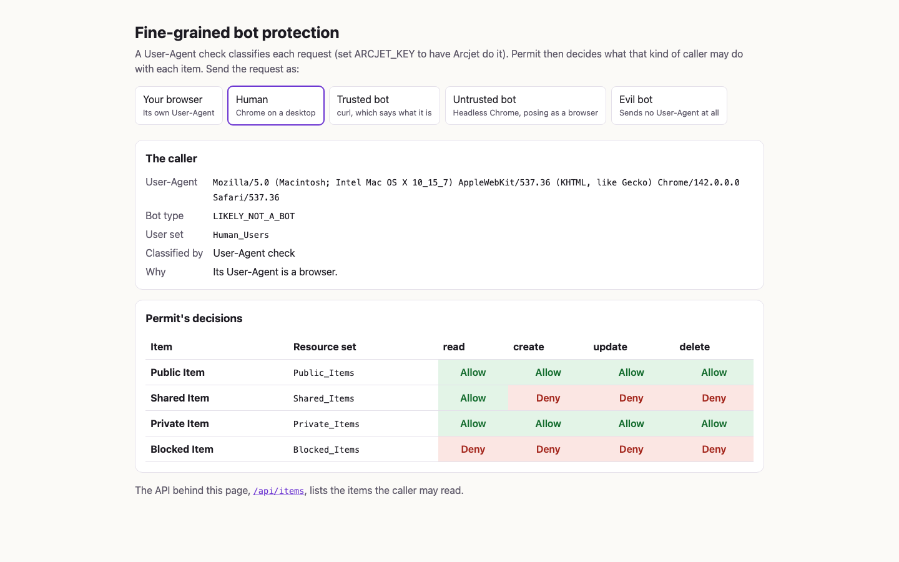
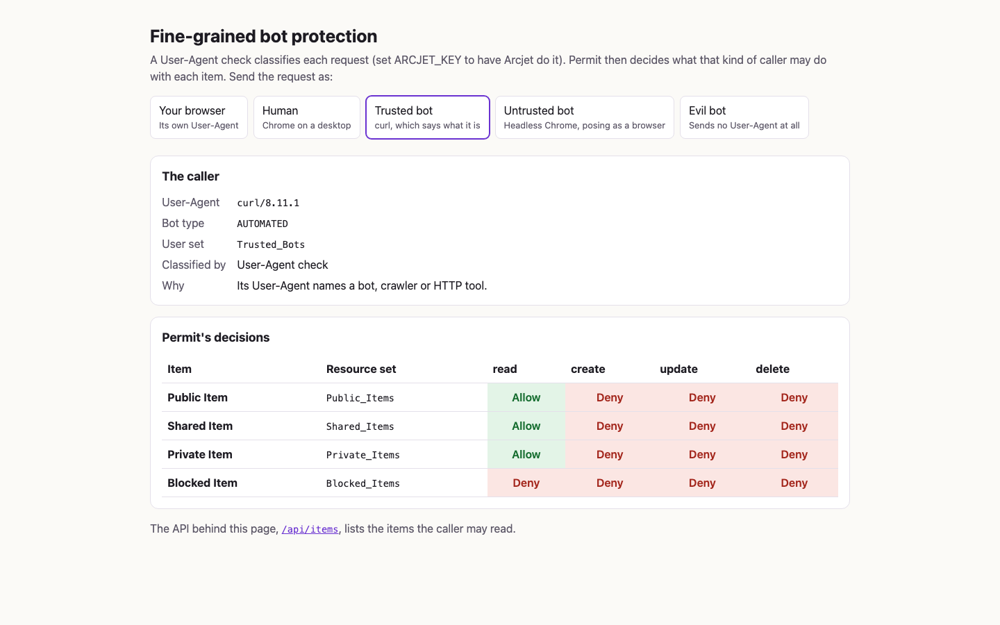
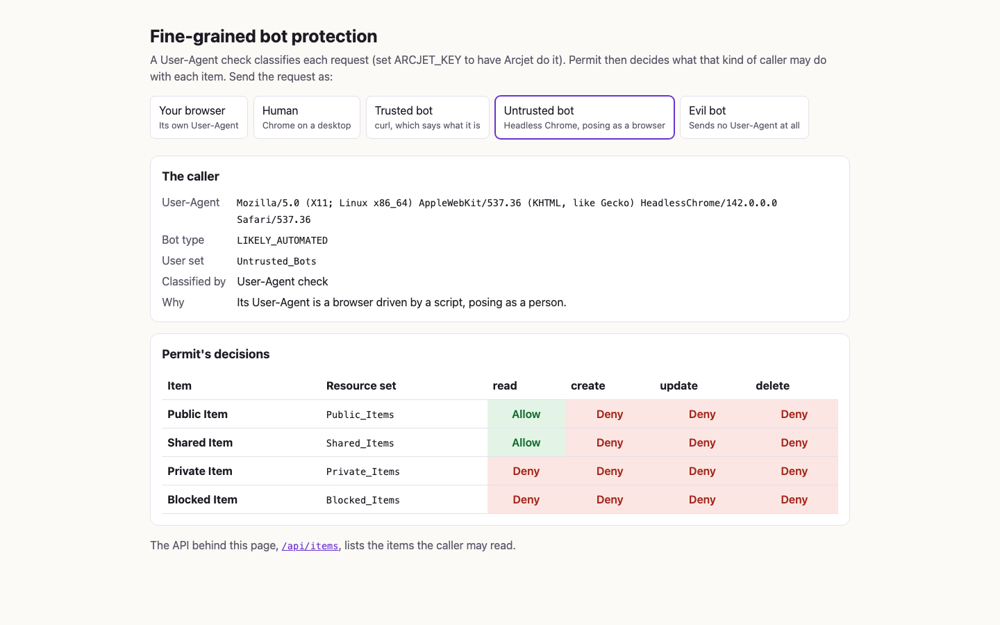
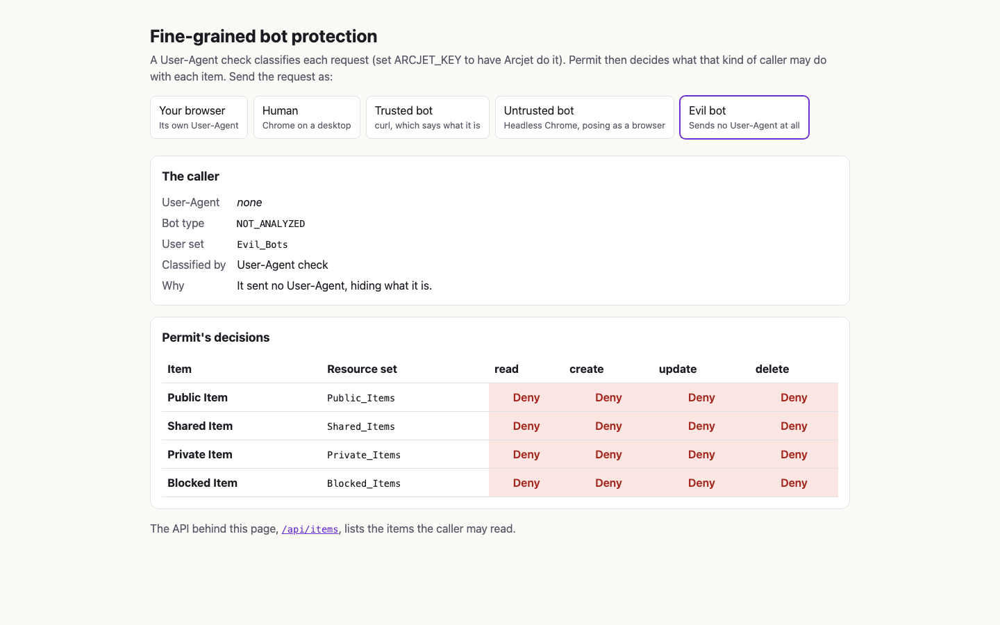
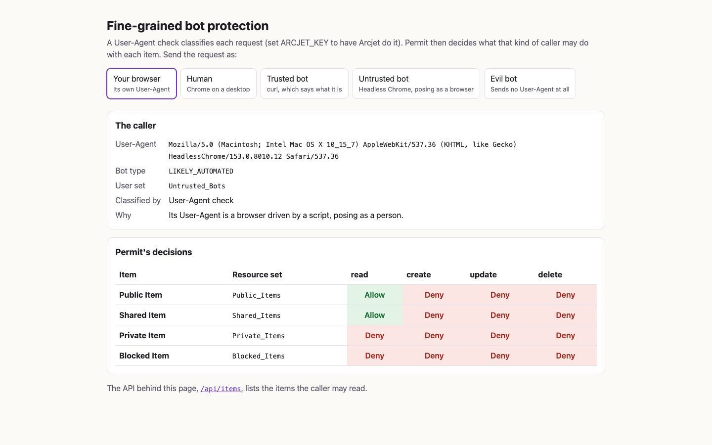

# Fine-grained bot protection

An Express app that gives humans, good bots and bad bots different access to the same content. Each request is first classified, by [Arcjet](https://arcjet.com) or by a User-Agent check, and the result goes to [Permit.io](https://www.permit.io) as an attribute of the user. Permit's policy decides what that kind of caller may do with each item.

The blog post [Introduce AI bots in your applications](https://www.permit.io/blog/introduce-ai-bots-in-applications) explains the idea and builds the same policy by hand in Permit's UI. Here a setup service writes it for you.

## What's in it

- **The app** (`src/`): a demo page at http://localhost:3000 and an API at `/api/items`. The API lists the items the caller may read; the page shows Permit's decision for every item and action, and lets you send the request as each kind of caller.
- **A local PDP** (`permitio/pdp-v2`), connected to your Permit environment, which makes the decisions.
- **`setup`**: a one-shot service that writes the policy and the demo user to your Permit environment, then waits until the PDP answers every check the app can send as the policy says. The app starts after it. It creates what is missing, updates what is there and removes the grants between its own user sets and resource sets that `GRANTS` does not list, so it is safe to run again and the environment ends up with exactly this policy. Grants that involve any other set are left alone.

Every request acts as the same signed-in user, `user@example.com`, so the only thing that changes Permit's answer is what kind of caller sent it. Setup creates that user in Permit: the resource sets compare an item's owner with the user's `key` attribute, which the PDP has only for users Permit knows. The `botType` attribute is not stored; the app sends it with every check.

## The callers

The buttons at the top of the page send the request with each caller's User-Agent in place of your browser's (a browser cannot change its own); "Your browser" sends your own. That swap, the page's `?as=` parameter, exists only for the demo: `/api/items` classifies each request as it arrives.

| Caller        | User-Agent it sends | `botType`          | User set         | May read                        |
| ------------- | ------------------- | ------------------ | ---------------- | ------------------------------- |
| Human         | Chrome on a desktop | `LIKELY_NOT_A_BOT` | `Human_Users`    | Public, Shared and Private Item |
| Trusted bot   | `curl/8.11.1`       | `AUTOMATED`        | `Trusted_Bots`   | Public, Shared and Private Item |
| Untrusted bot | Headless Chrome     | `LIKELY_AUTOMATED` | `Untrusted_Bots` | Public and Shared Item          |
| Evil bot      | none                | `NOT_ANALYZED`     | `Evil_Bots`      | nothing                         |

Humans may also create, update and delete their own items (Public and Private). No one may touch the Blocked Item.

From a terminal:

```
curl http://localhost:3000/api/items                       # curl: a trusted bot
curl -A 'HeadlessChrome/142.0.0.0' http://localhost:3000/api/items
curl -H 'User-Agent:' http://localhost:3000/api/items     # no User-Agent: an evil bot
```

## The policy

`src/policy.ts` holds the policy as data, and `src/write-policy.ts` turns it into Permit API calls.

- **Resource** `Content_Item`, with the actions `read`, `create`, `update` and `delete` and the attributes `owner` (string) and `private` (bool).
- **User attribute** `botType` (string): what kind of caller sent the request.
- **User sets**, on `botType`:

  | User set         | Matches `botType`                    |
  | ---------------- | ------------------------------------ |
  | `Human_Users`    | `LIKELY_NOT_A_BOT` or `VERIFIED_BOT` |
  | `Trusted_Bots`   | `AUTOMATED`                          |
  | `Untrusted_Bots` | `LIKELY_AUTOMATED`                   |
  | `Evil_Bots`      | `NOT_ANALYZED`                       |

- **Resource sets**, on the item's owner and `private`:

  | Resource set    | Owner is the user | Private | Demo item    |
  | --------------- | ----------------- | ------- | ------------ |
  | `Public_Items`  | yes               | no      | Public Item  |
  | `Shared_Items`  | no                | no      | Shared Item  |
  | `Private_Items` | yes               | yes     | Private Item |
  | `Blocked_Items` | no                | yes     | Blocked Item |

- **Grants**:

  |                  | `Public_Items` | `Shared_Items` | `Private_Items` | `Blocked_Items` |
  | ---------------- | -------------- | -------------- | --------------- | --------------- |
  | `Human_Users`    | all actions    | read           | all actions     | none            |
  | `Trusted_Bots`   | read           | read           | read            | none            |
  | `Untrusted_Bots` | read           | read           | none            | none            |
  | `Evil_Bots`      | none           | none           | none            | none            |

The grants follow the policy grid shown in the blog post. The post's text describes a stricter split (trusted bots read only public and shared items, untrusted bots only public ones); change `GRANTS` in `src/policy.ts` and run setup again to try it: `docker compose up --build` (or `pnpm setup-policy` in dev mode). Setup removes the grants you took out, and finishes once the PDP denies them.

## How a request is classified

The `botType` values are the names of Arcjet's earlier bot ranks, which the blog post's user sets match on. Arcjet's current SDK reports bots differently, so the app maps its findings onto those names. The app logs which classifier it runs when it starts:

```
Bot classifier: Arcjet (ARCJET_KEY is set)
Bot classifier: User-Agent check (ARCJET_KEY is not set)
```

**With `ARCJET_KEY`** (`src/arcjet-classifier.ts`), Arcjet's bot detection runs in `DRY_RUN` mode, so it only reports, and Arcjet Shield runs in `LIVE` mode. The first match decides:

1. Shield detects an attack: the app answers 403 and does not ask Permit.
2. `NOT_ANALYZED`: no User-Agent, a spoofed bot (one that claims to be Googlebot, say, from another network) or a known botnet.
3. `VERIFIED_BOT`: a bot whose identity Arcjet verified.
4. `LIKELY_AUTOMATED`: a script-driven browser (Headless Chrome, PhantomJS, Cypress), or a browser User-Agent from a hosting provider's network.
5. `AUTOMATED`: any other bot Arcjet identified (curl, crawlers, AI agents).
6. `LIKELY_NOT_A_BOT`: no sign of a bot.

If Arcjet cannot decide (a bad key, its API unreachable), the User-Agent check decides that request, and the page and the API say so.

**Without `ARCJET_KEY`** (`src/user-agent-classifier.ts`), the app reads only the User-Agent header. Any client can send any User-Agent, so this shows how the policy works and protects nothing. The first rule that matches decides:

1. No User-Agent: `NOT_ANALYZED`.
2. A script-driven browser (`HeadlessChrome`, `PhantomJS`, `Cypress`): `LIKELY_AUTOMATED`.
3. A bot, crawler or HTTP tool that names itself (`Googlebot`, `GPTBot`, `curl`, `python-requests`, …): `AUTOMATED`.
4. A browser (`Mozilla/5.0 (…`): `LIKELY_NOT_A_BOT`.
5. Anything else: `AUTOMATED`.

It never reports `VERIFIED_BOT`: telling a real Googlebot from a copy takes the caller's network address, which Arcjet checks.

## Requirements

- Docker with Compose.
- A Permit.io environment made for this example, and its environment API key. Setup writes the policy into it.
- Optional: an [Arcjet](https://app.arcjet.com) key.
- For dev mode: Node 24 (see `.nvmrc`) and pnpm through Corepack.

## Run it with Docker Compose

1. Copy the settings: `cp .env.example .env`, then set `PERMIT_API_KEY` (and `ARCJET_KEY` if you have one).
2. Build and start the PDP, the setup and the app: `docker compose up --build`
3. Open http://localhost:3000.

The app starts once setup has finished, which is when the PDP answers as the policy says. The PDP gets a policy change a few seconds after Permit stores it; if it still answers otherwise after a minute, setup fails and says which answer differs. `APP_PORT` and `PDP_PORT` in `.env` change the host ports (default 3000 and 7766). For a Permit backend running on your machine, set `PERMIT_API_URL=http://host.docker.internal:8000`.

## Run it in dev mode

1. Install: `corepack enable && pnpm install --frozen-lockfile`
2. Copy the settings: `cp .env.example .env`, then set `PERMIT_API_KEY`.
3. Start the PDP and write the policy: `docker compose up -d pdp setup`
4. Start the app with reload on change: `pnpm dev`, then open http://localhost:3000.

`pnpm dev` reads `.env` and finds the PDP at `PERMIT_PDP_URL` (default http://localhost:7766). `pnpm setup-policy` runs the setup from your machine instead of from Compose, and waits for the PDP at the same `PERMIT_PDP_URL`.

## Where the application asks Permit

Every line that calls Permit carries a `// Permit check:`, `// Permit read:` or `// Permit write:` comment:

```
git grep -n "// Permit \(check\|read\|write\):" src
```

The app asks Permit in one place: `src/authorize.ts` sends one `bulkCheck` per request, a check for each item and action, with the user's `botType` and the item's `owner` and `private` attributes. The reads and writes are the setup's, in `src/write-policy.ts`; then `src/wait-for-pdp.ts` sends the app's checks, through `src/authorize.ts`, until the PDP's answers match `GRANTS`.

## Screenshots

Taken with a local Permit backend and PDP, without an Arcjet key.

A human may do everything with its own items and read the shared one:



A trusted bot (curl) may read the public, shared and private items:



An untrusted bot (Headless Chrome) may read the public and shared items:



An evil bot (no User-Agent) may do nothing:



A headless browser opening the page with its own User-Agent is classified as an untrusted bot:



## Checks

Lint (oxlint, oxfmt, strict TypeScript) and test:

```
pnpm lint
pnpm test
```

`pnpm fix` applies the fixes both tools can make. CI runs these, a dependency audit and the Docker build on every push and pull request that changes this folder (`.github/workflows/fine-grained-bot-protection.yaml`).

## License

This folder is licensed under Apache-2.0 (see [LICENSE](LICENSE)); the rest of the repository is MIT.
