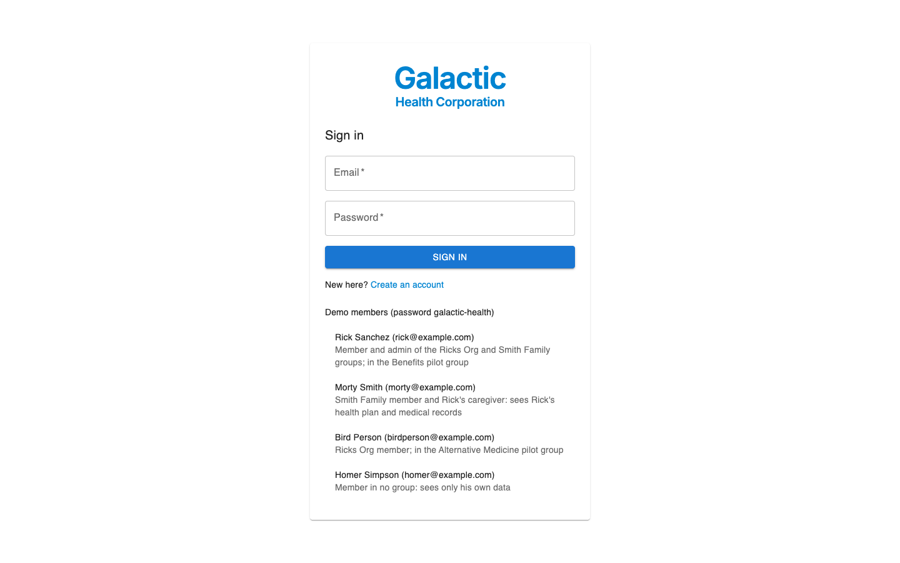
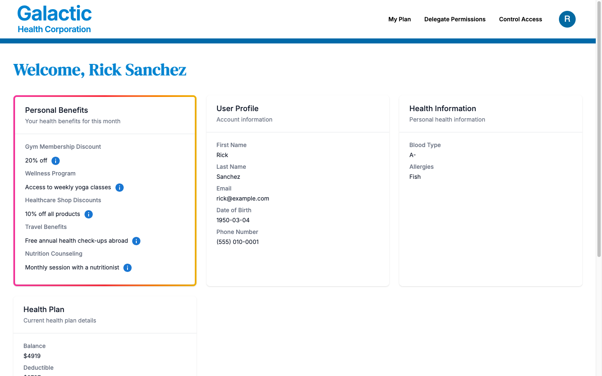
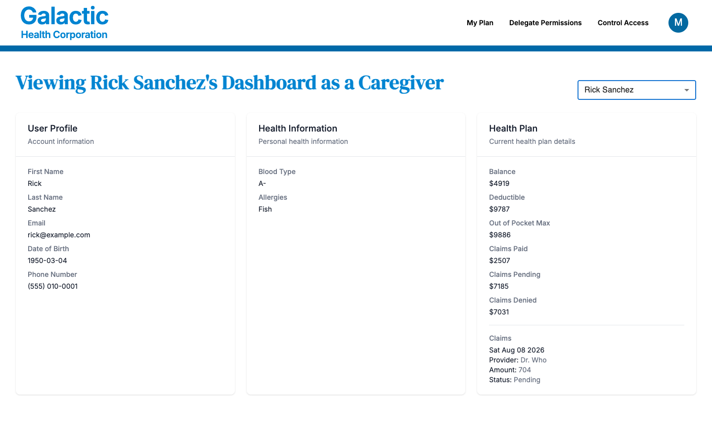
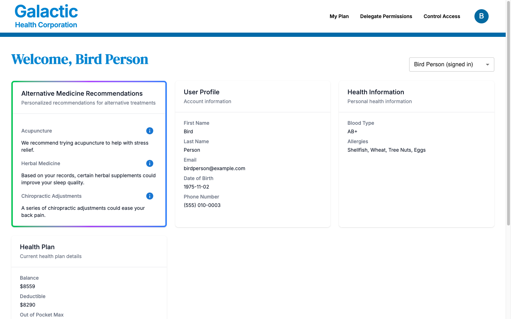
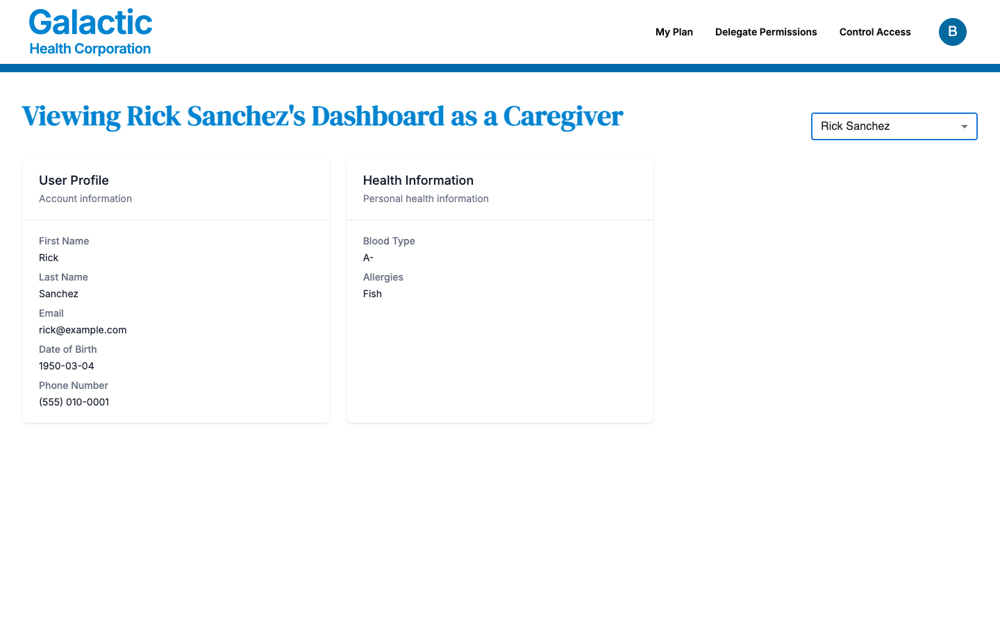
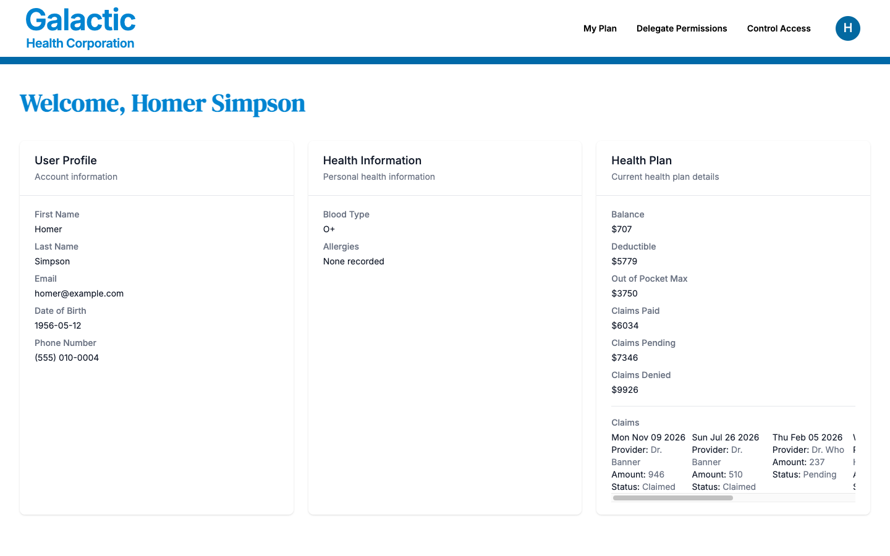
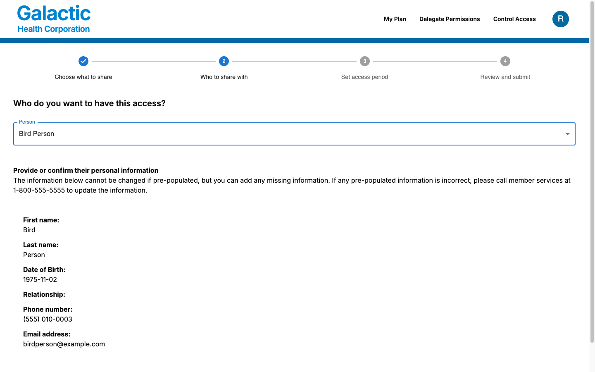
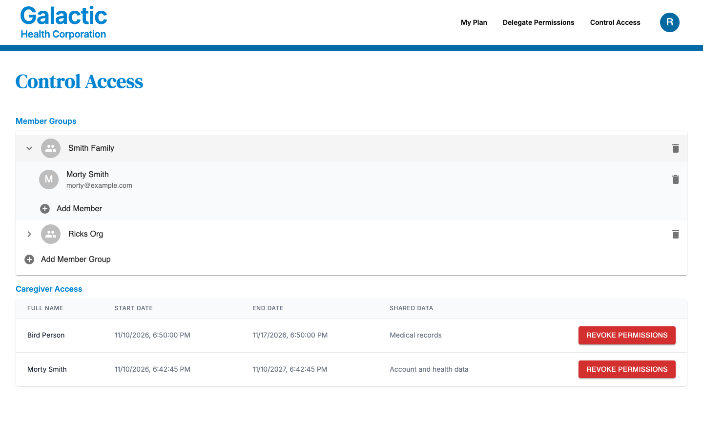
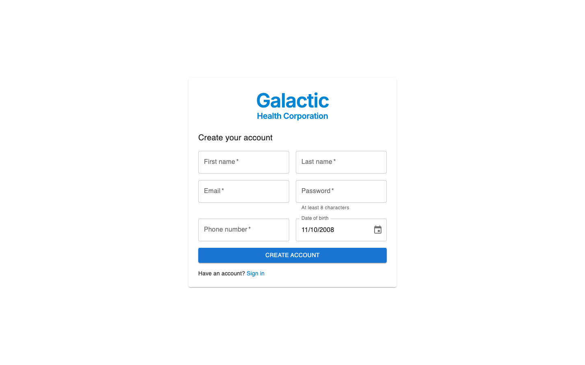

# Galactic Health Corporation

A healthcare portal where members, their caregivers and the admins of member groups see health plans, medical records and profiles. Every API route asks [Permit.io](https://www.permit.io) before it returns or changes anything, and the browser asks Permit which features to show. One application shows the three common permission models:

- **RBAC**: pilot groups. A tenant role (`benefits_pg_role`, `alt_medicine_pg_role`) shows a card on the member's dashboard.
- **ReBAC**: the owner of a member record owns its profile, health plan and medical records; a caregiver of the record, or of one of its parts, can read it; the members of a group can read the profiles in it.
- **ABAC**: each caregiver grant has a start and an end date. The app stores them as a user attribute; an optional custom Rego policy enforces them.

It was the `permitio/Galactic-Health-Corporation` repository.

## What's in it

- **The app** (`src/`): Next.js 16 (App Router) with MUI and Tailwind. Sign-in is [Better Auth](https://www.better-auth.com) with email and password, stored in a SQLite file through Node's built-in `node:sqlite`.
- **A local PDP** (`permitio/pdp-v2`), connected to your Permit environment, that answers the app's checks.
- **`setup`** (`scripts/setup.ts`): creates the policy and the demo members in your Permit environment and in the app's database. Safe to run again.
- **`policy/custom.rego`**: the optional Rego policy that enforces the caregiver dates, with its tests.

## The demo members

All demo members use the password `galactic-health`. The sign-in page lists them too.

| Member        | Email                    | What they show                                                                              |
| ------------- | ------------------------ | ------------------------------------------------------------------------------------------- |
| Rick Sanchez  | `rick@example.com`       | A member who administers the Ricks Org and Smith Family groups, in the Benefits pilot group |
| Morty Smith   | `morty@example.com`      | A Smith Family member and Rick's caregiver: he can open Rick's dashboard                    |
| Bird Person   | `birdperson@example.com` | A Ricks Org member in the Alternative Medicine pilot group                                  |
| Homer Simpson | `homer@example.com`      | A member in no group, with no caregivers: he sees only his own data                         |

New accounts from the sign-up page start like Homer: the owner of their own data and nothing else.

## Requirements

- Docker with Compose.
- A Permit environment made for this example, and its API key (Permit dashboard: Settings > API Keys). `setup` creates resources with plain keys such as `member` and `profile`, so don't use an environment you need for anything else.
- For dev mode: Node 24 (see `.nvmrc`) and pnpm (`corepack enable`).

## Run it with Docker Compose

1. `cp .env.example .env` and set `PERMIT_API_KEY`.
2. `docker compose up --build`
3. Open http://localhost:3000 and sign in as one of the demo members.

Compose starts the PDP, runs `setup` once, and starts the app when `setup` has finished and the PDP is healthy. The app's database and its session secret live in the `app-data` volume; `docker compose down -v` removes them, and the next `up` creates them again.

`APP_PORT` and `PDP_PORT` in `.env` change the host ports (3000 and 7766). To use a Permit backend running on your machine, set `PERMIT_API_URL=http://host.docker.internal:8000`.

## Run it in dev mode

1. `pnpm install --frozen-lockfile`
2. `cp .env.example .env` and set `PERMIT_API_KEY`.
3. Start the PDP: `docker compose up -d pdp`
4. Create the policy, the database and the demo members: `pnpm run setup`
5. `pnpm dev`, then open http://localhost:3000.

In dev mode the database and the session secret are in `.data/` (gitignored). The app finds the PDP at `PERMIT_PDP_URL`, by default http://localhost:7766.

## Try it

1. Sign in as Rick. The dashboard shows his profile, health information, health plan and the Benefits card (his pilot group).
2. Sign out and sign in as Morty. The plan selector next to the title lists Rick: Morty is his caregiver, so he can open Rick's dashboard. Bird Person sees only his own data, plus the Alternative Medicine card.
3. As Rick, open **Delegate Permissions** and give Bird Person access to your medical records for a week. Rick can choose only members of his groups. Sign in as Bird Person: Rick's dashboard is in the selector, with his profile (Bird Person is in one of Rick's groups) and medical records, but not his health plan.
4. As Rick, open **Control Access** to add or remove group members, and to revoke a caregiver.

## The policy

`scripts/policy.ts` creates it; this is what it holds.

| Resource          | Actions      | Roles                                   | Derived from                                                                               |
| ----------------- | ------------ | --------------------------------------- | ------------------------------------------------------------------------------------------ |
| `member_group`    | list, assign | admin (list, assign), org_member (list) |                                                                                            |
| `member`          | read, write  | owner (read, write), caregiver (read)   |                                                                                            |
| `profile`         | read, write  | owner (read, write), caregiver (read)   | owner from `member#owner`; caregiver from `member#caregiver` and `member_group#org_member` |
| `health_plan`     | read         | owner (read), caregiver (read)          | owner from `member#owner`; caregiver from `member#caregiver`                               |
| `medical_records` | read         | owner (read), caregiver (read)          | owner from `member#owner`; caregiver from `member#caregiver`                               |
| `benefits_pg`     | view         | tenant role `benefits_pg_role`          |                                                                                            |
| `alt_medicine_pg` | view         | tenant role `alt_medicine_pg_role`      |                                                                                            |

The derivations follow two relations: a `member` instance is the `parent` of the same member's `profile`, `health_plan` and `medical_records`, and a `member_group` instance `belongs` to the profiles of its admin and members. Instance keys carry the user key: `member:member_rick`, `health_plan:health_plan_rick`.

When someone signs up, the app registers them in Permit (`src/lib/members.ts`, called from the Better Auth hook in `src/lib/auth.ts`): the user with their phone number and date of birth as attributes, the owner role on their `member` instance, and the three `parent` relationships. If Permit cannot be reached, the sign-up is undone so it can be tried again.

## Where the app asks Permit

Each line that asks Permit carries a `// Permit check:` comment, each line that reads from Permit's API a `// Permit read:` comment, and each line that writes to it a `// Permit write:` comment:

```
git grep -n "Permit check" -- src
```

| Route                                                    | Permit check                                                        |
| -------------------------------------------------------- | ------------------------------------------------------------------- |
| `GET /api/account/profile/[user]`                        | read on `profile:profile_<user>`                                    |
| `GET /api/account/dashboard/health-plan/[user]`          | read on `health_plan:health_plan_<user>`                            |
| `GET /api/account/dashboard/medical-records/[user]`      | read on `medical_records:medical_records_<user>`                    |
| `GET`, `POST /api/account/caregiver`                     | write on the member's own `member` instance                         |
| `DELETE /api/account/caregiver/<caregiver>/<resource>`   | write on the member's own `member` instance                         |
| `POST /api/account/member-groups/assign`, `.../unassign` | assign on the group                                                 |
| `DELETE /api/account/member-groups`                      | assign on the group                                                 |
| `POST /api/permissions`                                  | a bulk check of what the page asked about, for the signed-in member |

`GET /api/account/member`, `GET /api/account/member-groups` and `GET /api/allowed-plans` list what Permit's API holds for the signed-in member (their groups, their members and their caregiver roles), and `POST /api/account/member-groups` creates a group with the member as its admin. Without a session every route answers 401; a deny is a 403; when the PDP is down the routes answer 503.

In the browser, `src/components/PermissionsProvider.tsx` uses [permit-fe-sdk](https://github.com/permitio/permit-fe-sdk) to send one bulk check to `POST /api/permissions`, and turns the answers into a [CASL](https://casl.js.org) ability. The dashboard shows each pilot-group card inside `<Can I="view" a="benefits_pg">`. Before it loads a member's dashboard, the page also asks `POST /api/permissions` which of the profile, health plan and medical records it may read, and requests only those.

## Caregiver dates (ABAC)

A caregiver grant stores its dates on the caregiver, as the `caregiver_bounds` user attribute keyed by resource instance:

```json
{
  "caregiver_bounds": {
    "member:member_rick": {
      "start_date": "2026-11-10T12:00:00.000Z",
      "end_date": "2027-11-10T12:00:00.000Z"
    }
  }
}
```

Permit's policy editor cannot express "this derived role holds only between two dates", so `policy/custom.rego` does it in Rego. Without it the app still stores and shows the dates, but Permit does not enforce them. To enforce them:

1. Set up [GitOps](https://docs.permit.io/integrations/gitops/github) for your Permit environment.
2. In the policy branch, replace the content of `custom/root.rego` with `policy/custom.rego`.
3. In `root.rego`, make the custom policy a condition of the same `allow` rule, and remove the second `allow` rule:

   ```rego
   allow {
   	policies.allow
   	custom.allow
   }
   ```

`policy/custom_test.rego` tests the policy with the OPA in the PDP image:

```
docker run --rm --entrypoint /app/bin/opa -v "$PWD/policy:/policy:ro" permitio/pdp-v2:0.9.16 test --v0-compatible /policy
```

## Screenshots

Taken with the demo members against a local Permit environment.

The sign-in page, with the demo members:



Rick's dashboard: his profile, health information and health plan, and the Benefits card of his pilot group:



Morty, Rick's caregiver, viewing Rick's dashboard. The pilot-group cards are not shown there:



Bird Person's own dashboard, with the Alternative Medicine card of his pilot group:



Bird Person viewing Rick's dashboard after Rick shared his medical records with him. The profile card comes from their shared group; the health plan stays hidden:



Homer, in no group and no pilot group, sees only his own data, with no plan selector:



Rick choosing a member of his groups in the Delegate Permissions wizard:



Rick's Control Access page, with his groups and his caregivers:



The sign-up page:



## Checks

```
pnpm lint
pnpm test
```

`pnpm lint` runs oxlint, oxfmt and strict TypeScript; `pnpm fix` applies the fixes oxlint and oxfmt can make. The tests call every API route with a real Better Auth session on an in-memory database, and replace the Permit SDK with a fake (`test/permit-fake.ts`). They also cover the sign-up hook, `setup`'s policy and seed, and the helpers.

CI runs these, a dependency audit, the Rego tests and the Docker build on every push and pull request that changes this folder (`.github/workflows/galactic-health-corporation.yaml`). Install the repository's prek hooks to run the same checks before each commit (see the [repository README](../README.md)).

## License

This folder is licensed under Apache-2.0 (see [LICENSE](LICENSE)), as its original repository was; the rest of this repository is MIT.
