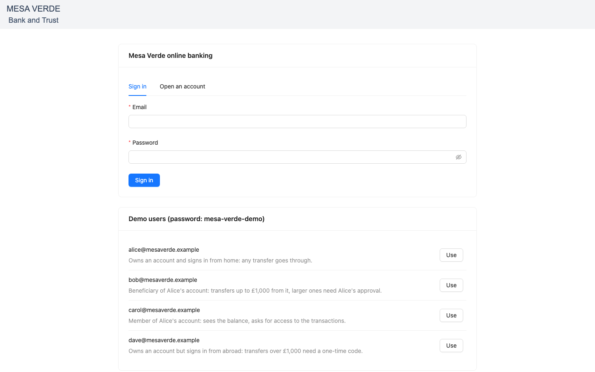
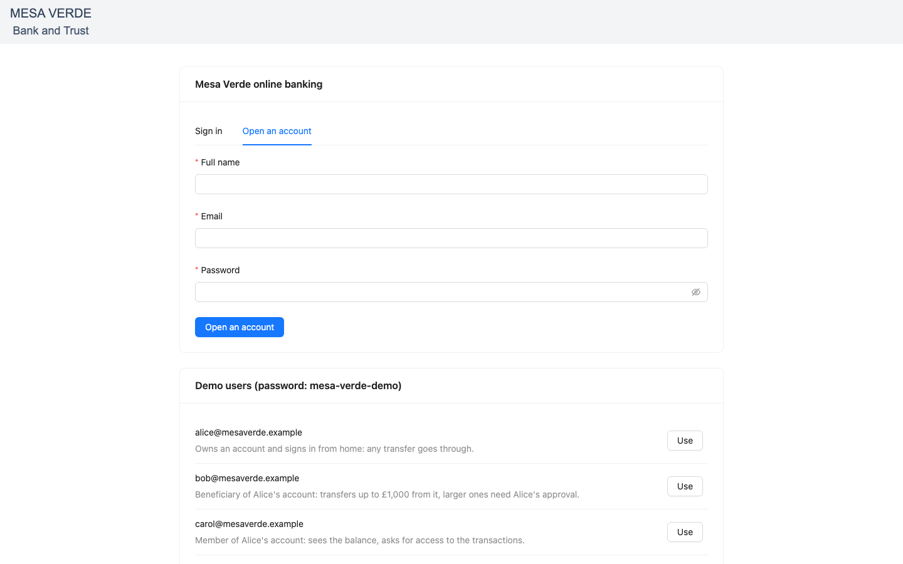
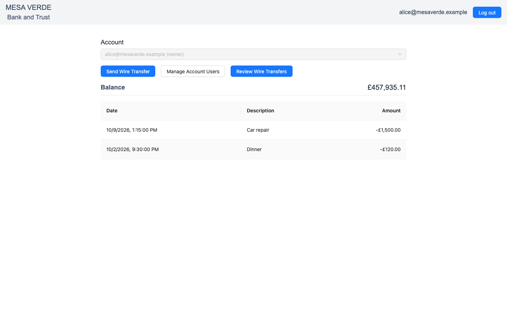
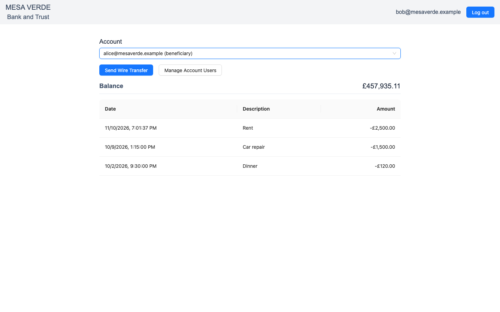
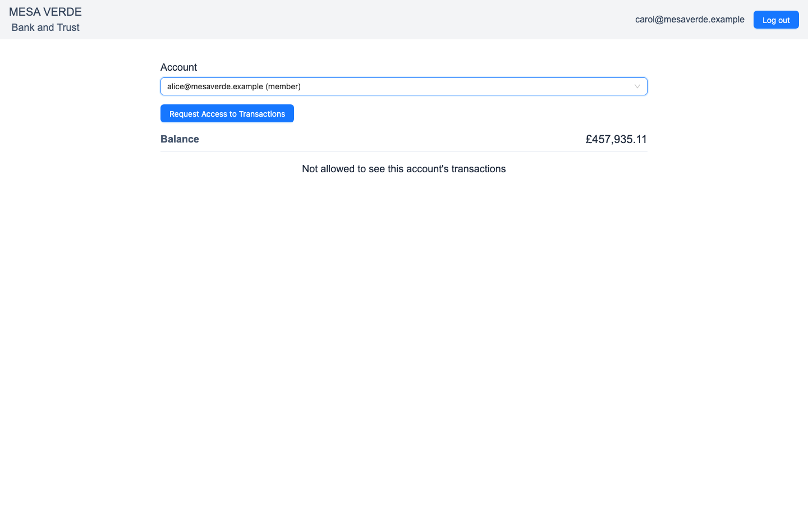
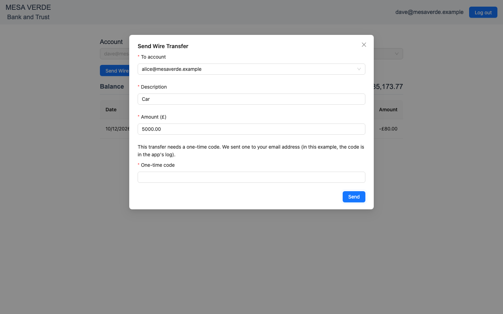
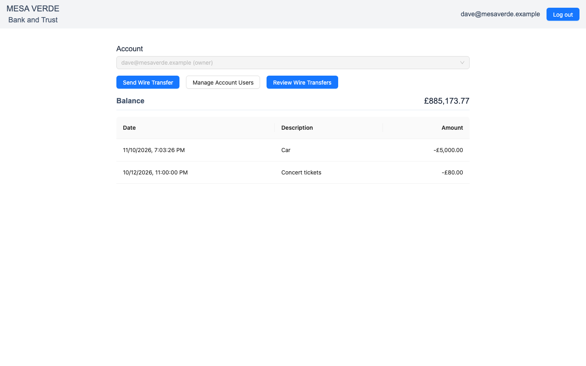

# Mesa Verde Bank

A banking app whose accounts, transactions and wire transfers are authorized by [Permit.io](https://www.permit.io). It combines multi-tenant role-based access control (RBAC), attribute-based access control (ABAC), relationship-based access control (ReBAC), a step-up one-time code, and approval flows built with Permit Elements. The [Fintech / Banking demo](https://docs.permit.io/modeling/mesa-verde) page of the Permit docs walks through its policy model.

## What it shows

- **Multi-tenant RBAC.** Each account is a Permit tenant. A user who signs in for the first time gets an account of their own, as its `AccountOwner`. Owners can add `AccountBeneficiary` and `AccountMember` users to their account.
- **Feature toggling in the UI.** The account page asks for five decisions in one bulk check (with `permit-fe-sdk`) and shows only the buttons the user may use.
- **Fine-grained wire transfers**, checked in two steps:
  1. `create` on `Wire_Transfer`, with the amount as a resource attribute. Owners may send any amount; beneficiaries up to £1,000 (the `Small_Wire` resource set). A denied transfer becomes a `Wire_Transfer` instance with the owner as its `_Reviewer_`, and the user asks for approval in the Operation Approval element.
  2. `create` on `Transaction`, with the user's current `location` and `strongAuth` as user attributes. Owners whose location matches the `country` of their registered address (`Safe_Owners`) may send any amount, other owners (`Unsafe_Owners`) up to £1,000, and owners who entered a one-time code (`Strong_Auth_Owners`) any amount. A denied transfer gets a one-time code from Better Auth's email-OTP plugin, and the user sends it again with the code.
- **ReBAC.** Every transaction is a `Transaction` instance with `Sender` and `Receiver` relationships. The transaction list is the account owner's `getUserPermissions` for `Transaction` instances: the ones sent from the account, and the ones sent to it (those live in the sender's account). Data writes go through the PDP, which answers once it has applied them, so a sent transfer is in the list at once.
- **Permit Elements**: User Management (Manage Account Users), Access Request (Request Access to Transactions), Operation Approval (asking for a transfer's approval) and Approval Management (Review Wire Transfers).

## The demo users

Setup creates four users, all with the password `mesa-verde-demo`. The sign-in page lists them too.

| User                      | Role                                           | Registered country | Signs in from | What to try                                                                                                       |
| ------------------------- | ---------------------------------------------- | ------------------ | ------------- | ----------------------------------------------------------------------------------------------------------------- |
| `alice@mesaverde.example` | Owner of their account                         | US                 | US            | Send any amount. Add users in Manage Account Users. Approve Bob's large transfers in Review Wire Transfers.       |
| `bob@mesaverde.example`   | Owner of their account, beneficiary of Alice's | GB                 | GB            | From Alice's account, send £1,000 or less; send more and ask Alice to approve it.                                 |
| `carol@mesaverde.example` | Owner of their account, member of Alice's      | US                 | US            | In Alice's account, see the balance but not the transactions; ask for access with Request Access to Transactions. |
| `dave@mesaverde.example`  | Owner of their account                         | US                 | FR            | Send more than £1,000: the app asks for a one-time code, which is in the app's log (`docker compose logs app`).   |

You can also open an account with any email address. A new user owns an account of their own, has no registered country, and needs a one-time code for every transfer.

The old demo looked up the user's location from the request's IP address, and their country in JSONBin. Locally every request comes from a private address, so both come from the `customer` table of the local database, which setup fills.

## Run it with Docker Compose

Requirements: Docker with Compose, and a Permit environment made for this example. Setup applies `main.tf` to it and adds the demo data, so use a fresh one.

1. Copy `.env.example` to `.env` and set `PERMIT_API_KEY` to the environment's API key (Settings > API Keys in Permit).
2. Start it: `docker compose up --build`
3. Open http://localhost:3000 and sign in as one of the demo users.

Compose starts three services:

- **`pdp`**: Permit's policy decision point (`permitio/pdp-v2`), on http://localhost:7766. The app sends every check to it.
- **`setup`**: runs once and exits. It applies `main.tf` with Terraform (the Permit provider, pinned in `.terraform.lock.hcl`), configures the four Elements, writes the demo accounts, users, roles and transactions to Permit, and creates the demo users in the local database. It is safe to run again: Terraform keeps its state in the `terraform-state` volume, and the API calls are upserts. If that volume is gone but the schema is still in the environment, setup skips Terraform and says so.
- **`app`**: the Next.js app, on http://localhost:3000, started once setup has finished and the PDP is healthy. Its SQLite database (Better Auth's users and sessions, and the `customer` table) is in the `app-data` volume.

`APP_PORT` and `PDP_PORT` in `.env` change the host ports. To run against a Permit backend on your machine, set `PERMIT_API_URL=http://host.docker.internal:8000`.

### One-time codes

There is no mail server, so Better Auth's email-OTP plugin writes each code to the app's log:

```
docker compose logs app | grep one-time
```

A code is valid for five minutes and works once.

### The approval webhook

When the account owner approves or denies a transfer in Approval Management, Permit can call the app's webhook (`/account/webhook`), which then records the approved transfer as a transaction. Permit has to reach the app for that, so the webhook is optional:

- Without it (the default), approvals work in the Elements, but the app does not hear of them, and an approved transfer does not show in the transactions.
- With it, set `PUBLIC_URL` to a URL Permit can reach the app at (for example `ngrok http 3000`) and `WEBHOOK_SECRET` to a long random value (`openssl rand -hex 32`), then run setup again (`docker compose up --build`). Setup registers `<PUBLIC_URL>/account/webhook` with the secret as its bearer token, and the app accepts only requests that carry it.

Setup cannot remove a webhook it registered on an earlier run (an environment API key may not delete webhooks). If you unset `PUBLIC_URL`, setup says so, and the app answers the webhook's calls with 404; remove it in Permit's Elements settings to stop them.

### Permit Elements

The Elements are iframes that `@permitio/permit-js` logs in to through the app's `/account/api/elements-login` route. By default they load from Permit's cloud (`https://embed.permit.io`). For another Permit deployment, set `PERMIT_ELEMENTS_URL` to where it serves the Elements, and `PERMIT_ELEMENTS_API_URL` to its API URL as the browser reaches it (for example `http://localhost:8000` when `PERMIT_API_URL` is `http://host.docker.internal:8000`). When the Elements cannot load, the rest of the app still works.

## Run it in dev mode

Requirements: Node 24 (see `.nvmrc`), pnpm (through Corepack), Terraform 1.5 or later, and Docker for the PDP.

1. Install: `corepack enable && pnpm install --frozen-lockfile`
2. Copy `.env.example` to `.env` and set `PERMIT_API_KEY`. In dev mode the app runs on your machine, so `PERMIT_API_URL` must be reachable from it (`http://localhost:8000` for a local backend, not `host.docker.internal`).
3. Start the PDP: `docker compose up -d pdp`
4. Run setup: `pnpm demo:setup`. It keeps the Terraform state in `terraform.tfstate` and the database in `data/`, both ignored by git.
5. Start the app: `pnpm dev`, then open http://localhost:3000.

## Where the application asks Permit

Every line that asks Permit carries a `// Permit check:` comment, and every line that writes to Permit a `// Permit write:` comment:

```
git grep -n "Permit check\|Permit write" src
```

| Route                                             | What it asks Permit                                                                 |
| ------------------------------------------------- | ----------------------------------------------------------------------------------- |
| `GET /account/api/tenants`                        | Reads the user's accounts; on the first visit, creates their account and owner role |
| `GET /account/api/tenants/all`                    | Lists the accounts a transfer can go to                                             |
| `GET /account/api/balance?tenant=`                | `read` on `Account`                                                                 |
| `GET /account/api/transactions?tenant=`           | `list` on `Transaction`, then the owner's `Transaction` instances                   |
| `POST /account/api/transactions?tenant=`          | `read` on `Account`, `create` on `Wire_Transfer`, then on `Transaction`; records it |
| `POST /account/api/frontend-permissions/[tenant]` | The UI's bulk check, for `permit-fe-sdk`                                            |
| `GET /account/api/elements-login?tenant=`         | An Elements login for the user in the account                                       |
| `POST /account/webhook`                           | Records an approved transfer, or deletes a denied one                               |

Every API route answers 401 without a Better Auth session, and 502 when Permit cannot be reached. A wire transfer answers 200 with a `status`: `sent`, or the next step, `approval_required` or `strong_auth_required` (the way payment APIs answer "requires action"). It answers 403 with a `code` when it is refused: `denied`, or `invalid_code` for a wrong or used one-time code.

Better Auth allows three sign-ins from one address until it has been idle for 10 seconds, so wait a moment between switching demo users quickly.

## Files

- `main.tf`: the policy schema, as Terraform: resources, roles, user attributes, user and resource sets, and the condition set rules.
- `scripts/setup.ts` and `src/setup/`: the setup: Terraform, the Elements (`elements.ts`), and the demo data (`seed.ts`).
- `src/lib/permit.ts`: the Permit SDK client and the data sync functions.
- `src/lib/auth.ts`: Better Auth, with email and password sign-in and the email-OTP plugin.
- `src/lib/personas.ts`: the demo users and transactions.
- `src/app/account/api/`: the API routes, where most checks are.
- `src/components/`: the UI, including the feature toggles (`AbilityContext.tsx`) and the Elements (`PermitElement.tsx`).

## Screenshots

Taken against a local Permit, at 1440×900.

The sign-in page, with the demo users:



Opening an account:



Alice, the owner, sees every action on the account:



Bob, a beneficiary of Alice's account, can send transfers and manage members, but not review transfers:



Carol, a member of Alice's account, sees the balance and can ask for access to the transactions:



Dave signs in from abroad, so a £5,000 transfer asks for a one-time code:



With the code, the transfer goes through:



## Checks

Lint (oxlint, oxfmt, strict TypeScript) and test:

```
pnpm lint
pnpm test
```

`pnpm fix` applies the fixes both tools can make. Comments wrap at 100 columns: oxfmt rewraps JSDoc comments, and a local oxlint rule, `tools/comment-width.ts`, rewraps `//` comments.

The tests run each API route against a real Better Auth with an in-memory database, and replace the Permit SDK's client with a fake. CI runs them, a dependency audit, a Terraform format and validate check of `main.tf`, and both Docker builds, on every push and pull request that changes this folder (`.github/workflows/mesa-verde-banking.yaml`). Install the repository's prek hooks to run the same checks before each commit (see the [repository README](../README.md)).

## License

MIT. The app started from a Stytch example and includes its code; the copyright notice is in [LICENSE](LICENSE).
