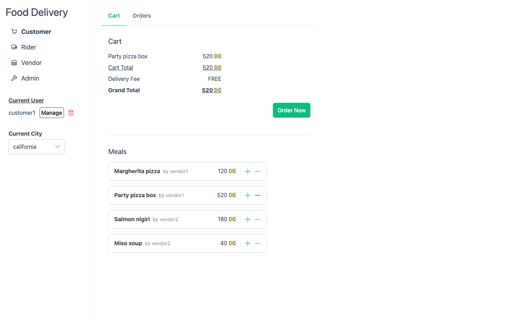
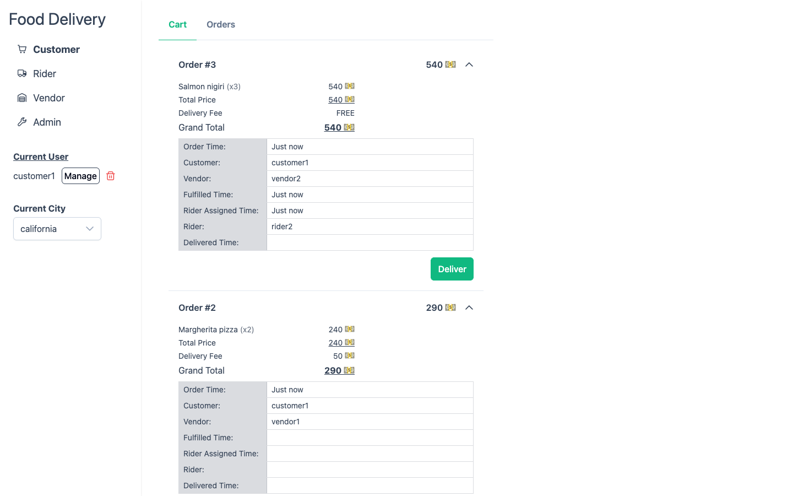
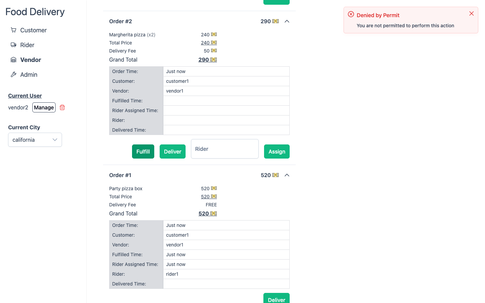
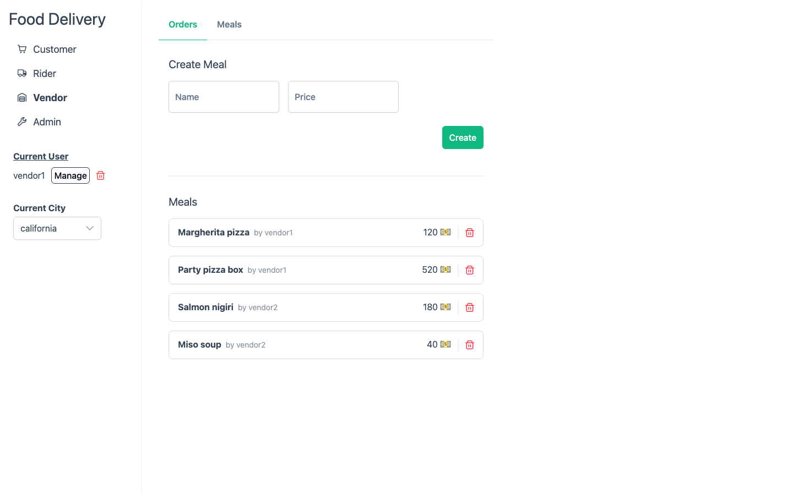
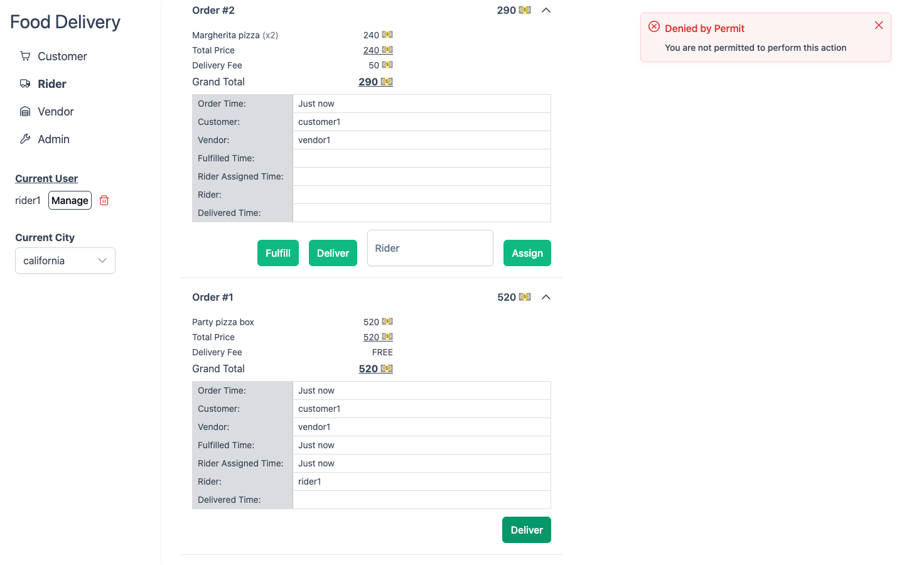
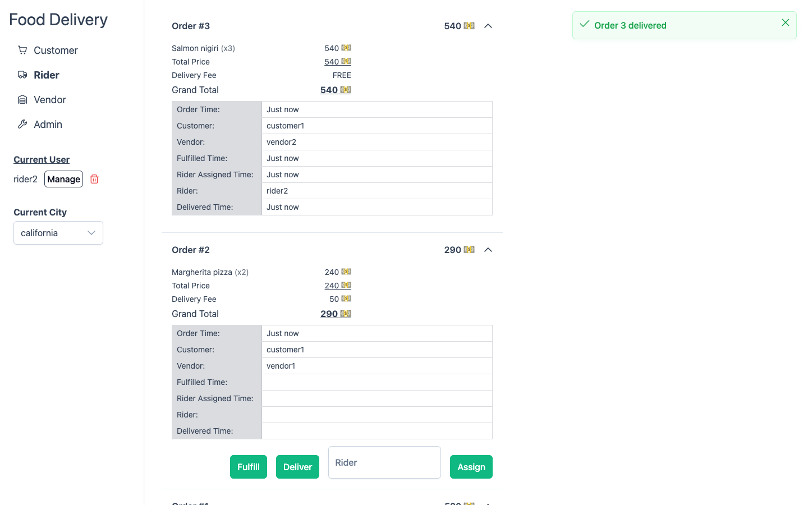
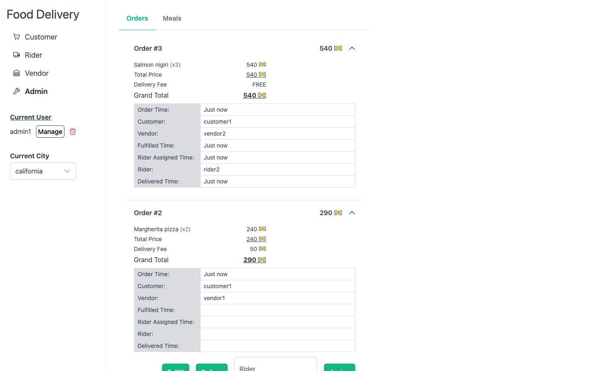
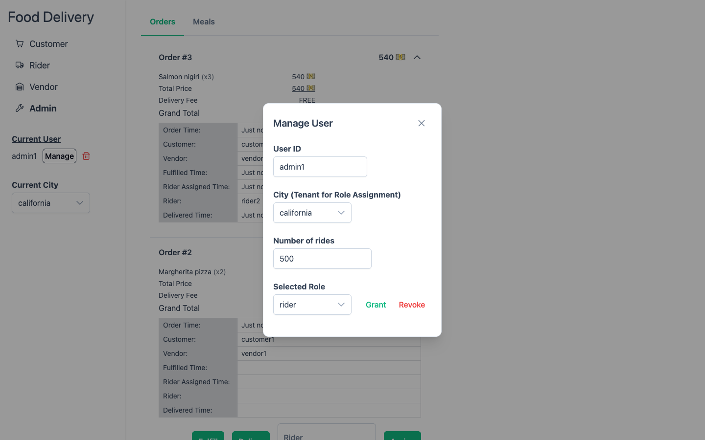
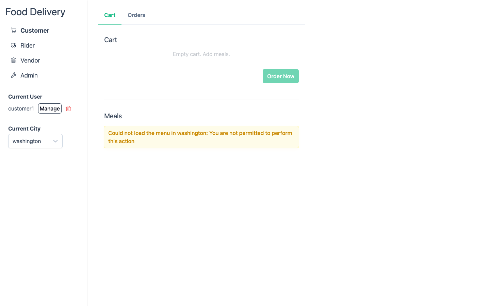

# Nuxt food delivery

A multi-city food delivery app whose server routes ask [Permit.io](https://www.permit.io) before every protected action. It combines three authorization models on the same actions: role-based (RBAC), attribute-based (ABAC) and relationship-based (ReBAC) access control, with each city as a separate tenant. The Permit guide [Food Delivery System Example](https://docs.permit.io/modeling/food-delivery-system-example-using-nuxt) walks through the same model.

Built with Nuxt 4, Vue 3, PrimeVue 4, Pinia, Tailwind CSS 4 and the `permitio` SDK, with a local Permit PDP in Docker Compose.

## What it shows

- **RBAC**: customers place orders, vendors manage meals, admins assign riders, and every role can see the menu and the orders.
- **Multitenancy**: California and Washington are Permit tenants. A role in one city grants nothing in the other.
- **ABAC**: an order of 500 or more gets free delivery (a resource set on the order's `cost`), and only a rider with 500 or more rides may deliver a free order (a user set on `number_of_rides`).
- **ReBAC**: placing an order makes the meals' vendor the order's `Vendor`, and assigning a rider makes them its `Rider`. Only that vendor may fulfill it and only that rider may deliver it.
- **Syncing data to Permit**: the app writes users, role assignments and each meal and order (as a resource instance) to Permit's API as they change.

## The personas

There is no sign-in. The sidebar's **Manage** dialog stands in for it: type any user key (or pick a demo user), choose a city, and grant or revoke a role. The app then acts as that user in that city. The setup service creates these users:

| User        | Role and city                      | What to try                                                       |
| ----------- | ---------------------------------- | ----------------------------------------------------------------- |
| `customer1` | customer in California             | Order the Party pizza box (520): delivery is free                 |
| `customer2` | customer in Washington             | Sees only Washington's menu and orders                            |
| `vendor1`   | vendor in California (pizza)       | Fulfills orders for their own meals                               |
| `vendor2`   | vendor in California (sushi)       | Is denied when fulfilling a pizza order                           |
| `vendor3`   | vendor in Washington (seafood)     | Manages Washington's menu                                         |
| `rider1`    | rider in California, 120 rides     | Delivers paid orders assigned to them; is denied free ones        |
| `rider2`    | rider in California, 650 rides     | Delivers free orders assigned to them                             |
| `admin1`    | admin in California and Washington | Assigns riders, and may fulfill and deliver any order in the city |

A walk through all three models:

1. As `customer1` in California, order the Party pizza box. The toast says delivery is free. Order a Margherita pizza: the fee is 50.
2. As `vendor2`, press **Fulfill** on the pizza order: denied. As `vendor1`: fulfilled.
3. As `admin1`, assign `rider1` to the free order. As `rider1`, press **Deliver**: denied, because the order is free and `rider1` has 120 rides. Deliver the paid order once it is assigned to `rider1`: allowed.
4. As `rider2`, try to deliver an order assigned to `rider1`: denied. Assign `rider2` to a free order and deliver it: allowed.
5. As `customer1`, switch the city to Washington: the menu does not load, because `customer1` has no role there.

## Requirements

- Docker with Compose.
- A Permit.io environment made for this example, and its API key (Permit dashboard: **Settings > API Keys**). The setup service writes this example's policy and demo users into it, so don't use an environment you need for anything else.
- For dev mode: Node 24 (see `.nvmrc`) and pnpm (`corepack enable`).

## Run it with Docker Compose

1. `cp .env.example .env` and set `PERMIT_API_KEY` in `.env`.
2. `docker compose up --build`
3. Open http://localhost:3000.

Compose starts three services:

- **`pdp`**: Permit's policy decision point (`permitio/pdp-v2`), connected to your environment, on port 7766. The app sends every check to it.
- **`setup`**: creates the policy, the demo users and the demo meals in your environment through Permit's API (`setup/setup.ts`), then exits. It is safe to re-run: `docker compose run --rm setup`.
- **`app`**: the Nuxt app, started once `setup` has finished and the PDP is healthy.

`APP_PORT` and `PDP_PORT` in `.env` change the host ports. To use a Permit backend running on this machine, set `PERMIT_API_URL=http://host.docker.internal:8000`.

Stop it with `docker compose down`. The app keeps its meals and orders in the `app-data` volume; `docker compose down -v` removes them, and the app starts again from the demo menu.

## Run it in dev mode

1. `cp .env.example .env` and set `PERMIT_API_KEY`. Leave `PERMIT_PDP_URL=http://localhost:7766`.
2. `corepack enable && pnpm install --frozen-lockfile`
3. Start only the PDP: `docker compose up -d pdp`
4. Create the policy and the demo data: `pnpm seed`
5. `pnpm dev`, then open http://localhost:3000.

In dev mode the app keeps its data in `.data/store.json`.

## Where the app asks Permit

Every route checks the caller in the city they picked, and the checks run in the route handlers under `server/routes/`. Each line that asks Permit carries a `// Permit check:` comment, and each line that writes to Permit a `// Permit write:` comment:

```
git grep -n "Permit check" server
```

| Route                          | Allowed for                                                                      | Checks                                                                                                                        |
| ------------------------------ | -------------------------------------------------------------------------------- | ----------------------------------------------------------------------------------------------------------------------------- |
| `GET /meals`, `GET /orders`    | any role in the city                                                             | `read` on `Meal` or `Order` (RBAC)                                                                                            |
| `POST /meals`                  | vendor, admin                                                                    | `create` on `Meal` (RBAC)                                                                                                     |
| `DELETE /meal/:id`             | vendor, admin                                                                    | `delete` on the meal (RBAC)                                                                                                   |
| `POST /orders`                 | customer, admin                                                                  | `create` on `Order` (RBAC), then `create-with-free-delivery` with the order's `cost`, which decides the delivery fee (ABAC)   |
| `POST /order/:id/fulfill`      | the order's vendor, admin                                                        | `fulfill` on the order (ReBAC through `Order#Vendor`, RBAC for admin)                                                         |
| `POST /order/:id/assign-rider` | admin                                                                            | `assign-rider` on the order (RBAC)                                                                                            |
| `POST /order/:id/deliver`      | the order's rider, admin; a free order also needs a rider with 500 or more rides | `deliver` on the order (ReBAC through `Order#Rider`, RBAC for admin); for a free order, also `deliver` with its `cost` (ABAC) |
| `POST /users`, `DELETE /users` | anyone: this is the demo's user switcher                                         | none                                                                                                                          |

`server/utils/api.ts` wraps `permit.check`: a deny answers 403, and a PDP or API failure answers 502 and is logged with what the app was doing.

Two choices keep the composite checks meaningful:

- **Vendors and riders get `fulfill` and `deliver` only through instance roles.** A tenant role applies to every order in the city, so if the `vendor` role had `fulfill`, every vendor could fulfill every order. Only `admin` holds them as a tenant role.
- **The order's `cost` goes with the checks, not onto the order's resource instance.** A check with an order's key also matches the ABAC rules against the attributes Permit stores for that order. If orders carried `cost`, the experienced-riders rule would let any rider with 500 or more rides deliver any free order, assigned to them or not. Passing `cost` only with the two checks that need it keeps the keyed `deliver` check a relationship check.

## The policy

`setup/policy.ts` holds the whole policy as data, and `setup/setup.ts` writes it:

- **Resources**: `Meal` (`create`, `read`, `update`, `delete`) and `Order` (`create`, `read`, `fulfill`, `assign-rider`, `deliver`, `create-with-free-delivery`, and a numeric `cost` attribute).
- **Tenant roles**: `customer`, `vendor`, `rider` and `admin`, in the tenants `california` and `washington`.
- **Instance roles** on `Order`: `Vendor` (`fulfill`) and `Rider` (`deliver`).
- **User attribute**: `number_of_rides` (number).
- **Condition sets**: the resource set `orders_above_500` (`cost` of 500 or more) and the user set `experienced_riders` (`number_of_rides` of 500 or more).
- **ABAC rules**: `customer` and `admin` may `create-with-free-delivery` on `orders_above_500`; `experienced_riders` may `deliver` on `orders_above_500`.

The guide builds the same model by hand in the Permit dashboard. Its RBAC step gives vendors `fulfill` and riders `deliver` as tenant roles; this example leaves those to the instance roles, as explained above.

## Data

The app keeps meals and orders in a JSON file (`server/utils/store.ts`), standing in for a database, and starts with the demo menu. Permit holds only what it decides on: each meal and order as a resource instance with its city, and who holds which role. Each city keeps its newest 10 meals and 50 orders; the app removes older ones from Permit too. Order numbers start again at 1 when the data is reset (`docker compose down -v`); if Permit still holds an order instance with that number, the app deletes it, with the roles on it, before registering the new order.

## Screenshots

Taken against a local Permit environment set up by the setup service.

`customer1` in California with the Party pizza box in the cart. The cart previews free delivery; Permit decides it when the order is placed (ABAC on the order's cost).



The Orders tab lists every order in the city, with its delivery fee and progress.



`vendor2` presses **Fulfill** on an order of `vendor1`'s pizza: Permit denies it (ReBAC: `vendor2` is not the order's `Vendor`).



`vendor1`'s menu tab, where vendors and admins create and remove meals (RBAC).



`rider1`, assigned to a free-delivery order, presses **Deliver**: Permit denies it, because `rider1` has 120 rides and free orders need 500 (ABAC).



`rider2`, with 650 rides, delivers the free order assigned to them (ReBAC and ABAC).



`admin1` sees every order in the city, with the form to assign a rider.



The **Manage** dialog, which stands in for sign-in: grant or revoke a role in a city, with the number of rides for a rider.



`customer1` switched to Washington, where they have no role: the menu does not load (multitenancy).



## Dependencies

The UI uses PrimeVue 4.5, the last MIT-licensed PrimeVue release. PrimeVue 5 ships under a commercial license that requires a license key.

`pnpm-workspace.yaml` overrides two of Nuxt's build-time dependencies to versions that fix open advisories, and records the one advisory without a fixed release, with the reason it does not apply.

## Checks

Lint (oxlint, oxfmt, strict TypeScript through `nuxt typecheck`) and test:

```
pnpm lint
pnpm test
```

`pnpm fix` applies the fixes both tools can make. Comments wrap at 100 columns: oxfmt rewraps JSDoc comments, and a local oxlint rule, `tools/comment-width.ts`, rewraps `//` comments.

The tests serve the API routes in-process with h3 and replace the `permitio` SDK's `Permit` client with a fake, so they need neither a PDP nor a Permit account. CI runs these, a dependency audit and the Docker build on every push and pull request that changes this folder (`.github/workflows/nuxt-food-delivery.yaml`). Install the repository's prek hooks to run the same checks before each commit (see the [repository README](../README.md)).
