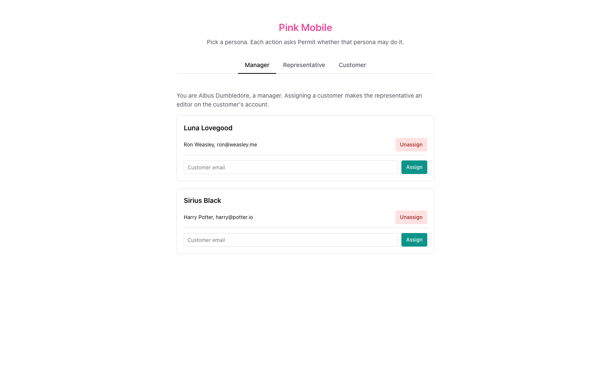
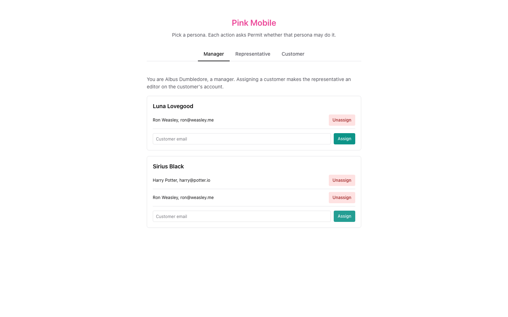
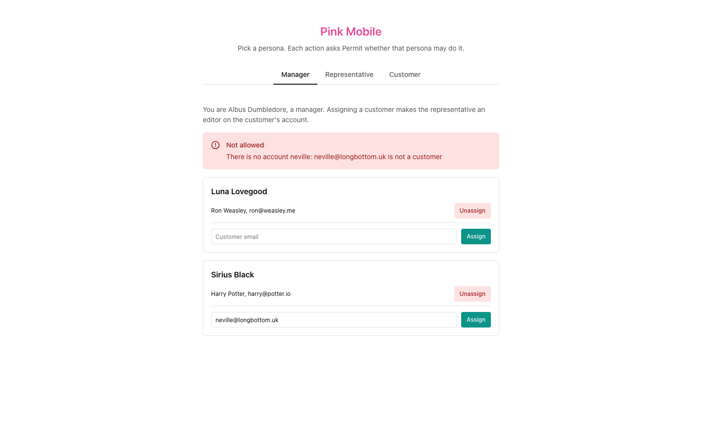
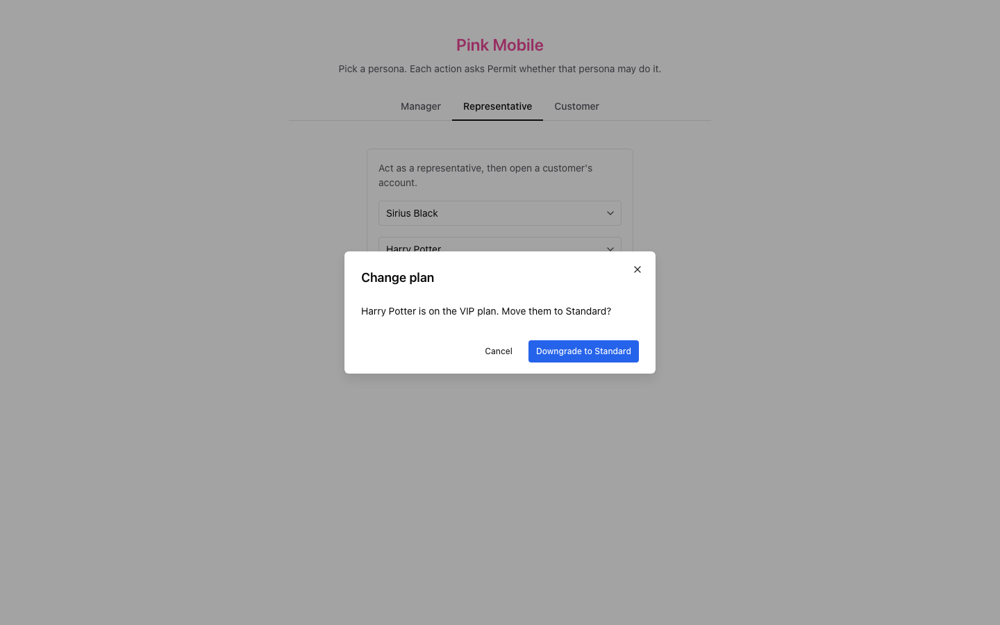
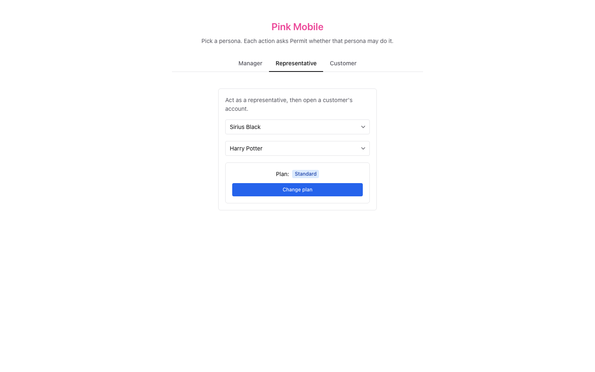
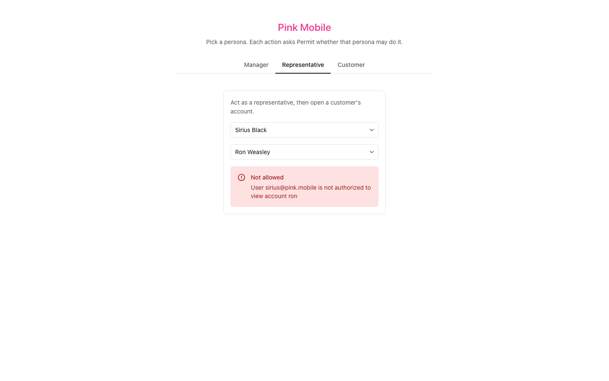
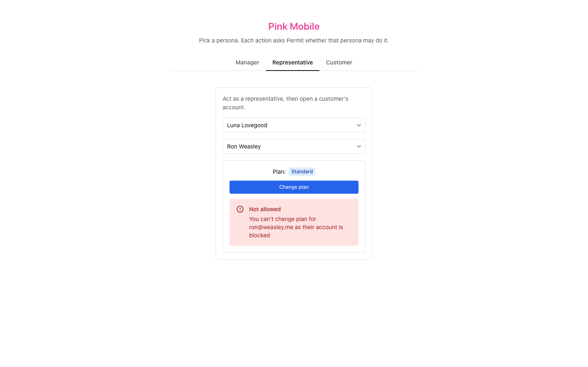
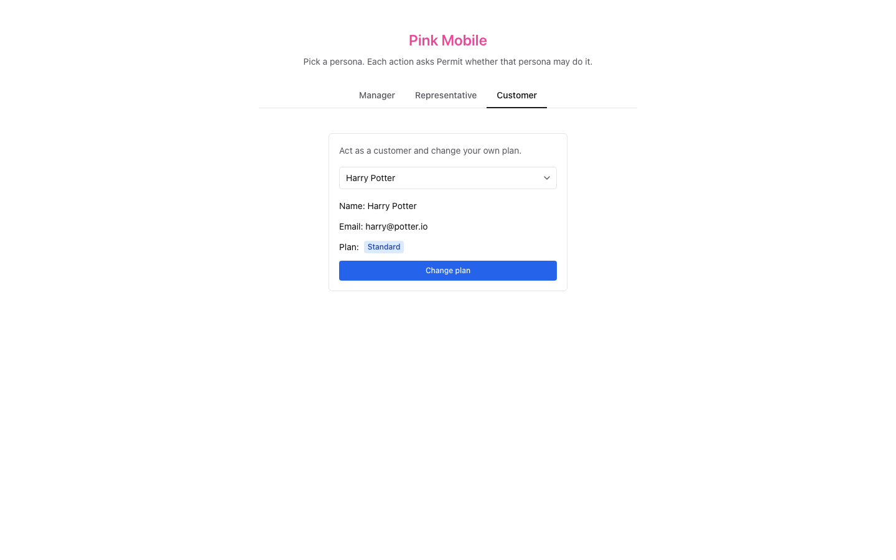
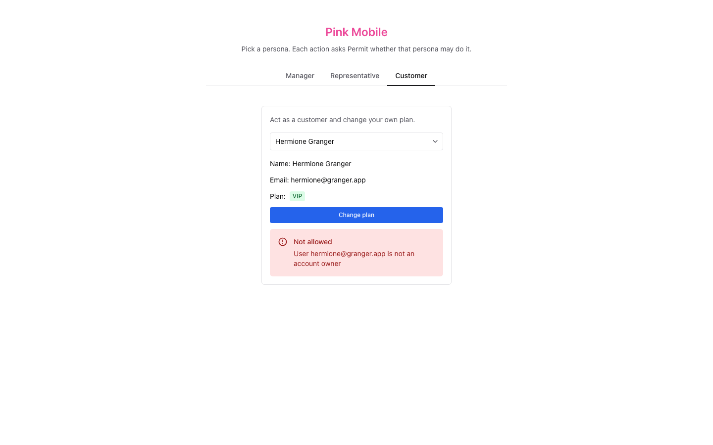

# Pink Mobile

A phone plan management app whose every action asks [Permit.io](https://www.permit.io) first. A manager, representatives and customers share one policy that combines role-based (RBAC), relationship-based (ReBAC) and attribute-based (ABAC) access control, and a local Permit PDP makes the decisions.

The tabs at the top of the page stand in for sign-in: each tab acts as a different user, and the page sends that user's key in the `X-User` header. In production, the identity provider authenticates users; Permit only authorizes them.

The Permit docs explain the policy model step by step: [Teleco demo application](https://docs.permit.io/modeling/pink-mobile).

## What's in it

- **A Next.js app** (Pages Router, Chakra UI). The API routes in `pages/api` ask Permit through the `permitio` SDK before they read or change anything (http://localhost:3000).
- **`lib/policy.ts`**: the policy and the demo data. `scripts/setup.ts` writes them to your Permit environment, and is safe to re-run.
- **`scripts/check-policy.ts`**: asks a running PDP the questions the routes ask, and compares the answers with the demo's starting state.
- **`docker-compose.yml`**: the PDP (`permitio/pdp-v2`), a one-shot `setup` service, and the app.

## The policy

| Resource          | Actions          | Roles and relations                                                                         |
| ----------------- | ---------------- | ------------------------------------------------------------------------------------------- |
| `representatives` | `list`, `assign` |                                                                                             |
| `users`           | `list`, `create` |                                                                                             |
| `account`         | `manage`, `view` | `owner` (manage, view), `editor` (view), `member` (view)                                    |
| `plan`            | `change`, `view` | `parent` relation to an account; `editor` (change, view), granted to the account's `editor` |

- **RBAC**: the `manager` role may list and assign representatives, list users, and view accounts and plans. The `representative` role may list users.
- **ReBAC**: each customer's account is the `parent` of their plan, so a representative who is an `editor` on `account:harry` is an `editor` on `plan:harry`.
- **ABAC**: the `blocked` user attribute splits users into `active_users` and `blocked_users`. The `owned_plans` resource set matches plans whose `owner` is the user. Active users may view and change the plans they own; blocked users may only view them.

## The personas

| User                                      | Tab            | Starting state                                         |
| ----------------------------------------- | -------------- | ------------------------------------------------------ |
| Albus Dumbledore (`albus@pink.mobile`)    | Manager        | `manager`                                              |
| Sirius Black (`sirius@pink.mobile`)       | Representative | `representative`, `editor` on `account:harry`          |
| Luna Lovegood (`luna@pink.mobile`)        | Representative | `representative`, `editor` on `account:ron`            |
| Harry Potter (`harry@potter.io`)          | Customer       | `owner` of `account:harry`, VIP plan                   |
| Hermione Granger (`hermione@granger.app`) | Customer       | `member` of `account:harry`, owns no account, VIP plan |
| Ron Weasley (`ron@weasley.me`)            | Customer       | `owner` of `account:ron`, Standard plan, `blocked`     |

### What to try

**Representative tab.** Pick a representative, then a customer:

- Sirius and Harry: the plan shows, and Sirius can change it.
- Sirius and Ron: denied, because Sirius is not an editor on Ron's account.
- Any representative and Hermione: denied, because Hermione is not an account owner.
- Luna and Ron: the plan shows, but changing it is denied, because Ron is blocked.

**Manager tab.** Assign `ron@weasley.me` to Sirius. Sirius can now open Ron's account in the Representative tab; changing Ron's plan is still denied, because Ron is blocked. Unassign Ron to undo it.

**Customer tab.** Harry can change his own plan. Ron is denied because he is blocked, and Hermione because she does not own an account.

Running setup again puts every demo user's roles and attributes back to the starting state.

## Requirements

- Docker with Compose. For dev mode, also Node 24 (see `.nvmrc`).
- A Permit.io environment made for this example, and its API key. Setup creates the resources, roles and condition sets above in it, and resets the six demo users each time it runs.

## Run it with Docker Compose

1. Copy `.env.example` to `.env` and set `PERMIT_API_KEY`.
2. Start it: `docker compose up --build`. Compose starts the PDP, runs `setup` once (it creates the policy and the demo data, then exits), and starts the app once setup has finished and the PDP is healthy.
3. Open http://localhost:3000.

`APP_PORT` and `PDP_PORT` in `.env` change the host ports. To use a Permit backend running on this machine, set `PERMIT_API_URL=http://host.docker.internal:8000`; the PDP and the setup service use it.

Reset the demo while the stack runs with `docker compose run --rm setup`. The PDP receives each change from Permit within a few seconds.

## Run it in dev mode

1. Install: `corepack enable && pnpm install --frozen-lockfile`
2. Copy `.env.example` to `.env` and set `PERMIT_API_KEY`.
3. Start only the PDP: `docker compose up -d pdp`
4. Create the policy and the demo data: `pnpm seed`
5. Start the app: `pnpm dev`, then open http://localhost:3000.

## Check the policy against the PDP

```
pnpm check:policy
```

It asks the PDP at `PERMIT_PDP_URL` 17 questions, one line each, such as whether Sirius may change `plan:harry` and whether Ron may change his own plan, and exits with 1 if any answer differs from the starting state. With the Compose stack running, the same check runs inside it with `docker compose run --rm setup node scripts/check-policy.ts`. CI does not run it: it needs a PDP connected to a Permit environment.

## Where the application asks Permit

Every line that asks Permit carries a `// Permit check:` comment, and every line that writes to Permit a `// Permit write:` comment:

```
git grep -n "Permit check" pages
```

| Route                                                             | Persona                    | What Permit decides                                                                                                                                                                  |
| ----------------------------------------------------------------- | -------------------------- | ------------------------------------------------------------------------------------------------------------------------------------------------------------------------------------ |
| `GET /api/representative`                                         | Manager                    | `list` on `representatives`                                                                                                                                                          |
| `POST` and `DELETE /api/representative/:representative/:customer` | Manager                    | `assign` on `representatives`; a new assignment also needs the `representative` role. Then the representative's `editor` role on the customer's account is written                   |
| `GET /api/user`                                                   | Manager, representative    | `list` on `users`                                                                                                                                                                    |
| `GET /api/account/:customer`                                      | Representative             | the customer has `manage` on their account (they own it), and the representative has `view` on it                                                                                    |
| `POST /api/plan/:customer/:plan`                                  | Representative or customer | the customer has `manage` on their account (they own it); a representative also needs `change` on the customer's plan; and the customer must be active (`change` on a plan they own) |

`lib/authorizer.ts` wraps `permit.check()` and the SDK's API calls. The lists come from role assignments: `listRepresentatives` reads the `representative`, `editor` and `owner` assignments in parallel and joins them.

## Screenshots

Taken against a local Permit backend with the demo's starting data.

**Manager.** The representatives and their customers; assigning Ron to Sirius; assigning an email that has no account.





**Representative.** Sirius changes Harry's plan; Sirius may not open Ron's account; Luna may open Ron's account but not change the plan of a blocked customer.






**Customer.** Harry changes his own plan; Hermione, who owns no account, may not.




## Checks

Lint (oxlint, oxfmt, strict TypeScript) and test:

```
pnpm lint
pnpm test
```

`pnpm fix` applies the fixes both tools can make. The tests call every API route with the Permit SDK mocked, including denies and Permit failures, and check the requests setup builds.

CI runs these, a dependency audit and the Docker build on every push and pull request that changes this folder (`.github/workflows/pink-mobile.yaml`). Install the repository's prek hooks to run the same checks before each commit (see the [repository README](../README.md)).

## License

This folder is Apache-2.0 (see [LICENSE](LICENSE)); the rest of the repository is MIT.
